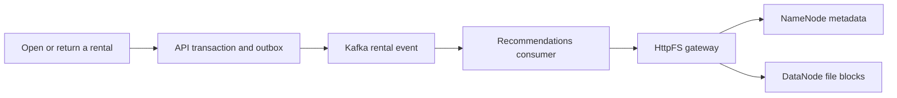

# Hadoop from zero: read the code, run the lab, prove what happened

Start here if Hadoop is new to you. Work through the **local** exercises first,
then repeat them in **Kubernetes**. Do not start both environments simultaneously.
The HDFS implementation and this guide are delivered together in this repository.
Start from this guide, then follow its links to the code and system design.

By the end you should be able to explain where an event lives, locate its file,
prove a replay does not overwrite it, and diagnose an unavailable archive.
You do not need Spark, a Hadoop certification or a new Java service for this lab.

<a id="step-1"></a>

## 1. Learn six words before running anything

<a id="phase-1-reading"></a>

### Read before the first lab

Follow this short reading checklist in order. Each item explains what to look
for; you do not need to read every page or install another tool yet.

- [ ] Read the introduction on [Apache Hadoop](https://hadoop.apache.org/).
  Identify Hadoop as an ecosystem that includes storage and processing, rather
  than a single database. In this lab we use its HDFS storage components.
- [ ] Read **Introduction** and **NameNode and DataNodes** in the
  [HDFS architecture guide](https://hadoop.apache.org/docs/r3.5.0/hadoop-project-dist/hadoop-hdfs/HdfsDesign.html).
  Explain who stores file metadata and who stores the actual blocks.
- [ ] Read the overview of [HttpFS: Hadoop HDFS over HTTP](https://hadoop.apache.org/docs/r3.5.0/hadoop-hdfs-httpfs/index.html).
  Explain why a Java HTTP client can access HDFS through a gateway.
- [ ] Read the opening explanation of [Spark SQL](https://spark.apache.org/sql/).
  Distinguish querying/processing data from storing files. Spark is a future
  stage, not a prerequisite to run this lab.
- [ ] Read the [project architecture diagram](recommendations-hdfs.md#boundaries-and-topology)
  and locate those components in [compose.yaml](../compose.yaml).
  Find `hdfs-namenode`, `hdfs-datanode` and `hdfs-httpfs`; do not change them yet.
- [ ] Use the glossary below to explain all six terms before continuing to
  [step 2](#step-2).


| Word | Plain explanation | In this project |
| --- | --- | --- |
| Hadoop | An ecosystem for distributed storage and processing | We use its HDFS storage components |
| HDFS | A filesystem distributed across machines | Stores the original rental event JSON |
| NameNode | Tracks filenames, directories and the blocks belonging to each file | Knows where an event's blocks are stored |
| DataNode | Stores the actual file blocks | Holds the JSON bytes |
| HttpFS | An HTTP gateway to HDFS | Lets Spring RestClient read/write without a Hadoop Java client dependency |
| Spark | A computation engine that can read these files later | **Not installed or implemented** in this stage |

A NameNode is not a relational database for your rental queries. HDFS does not
turn JSON into SQL tables automatically. The NameNode UI browses storage and
cluster health; it does not calculate revenue or recommend cars.



**Checkpoint:** describe the difference between Kafka retaining a message and
HDFS retaining a file. Both persist data, but they serve different access and
processing models. Kafka retention does not delete an archived HDFS file.

<a id="step-2"></a>

## 2. Know what is and is not connected

The API saves a rental and an outbox record in PostgreSQL. Its publisher sends
the event to Kafka. Recommendations validates that event and, when enabled,
archives it before the listener returns successfully.

There is no new PostgreSQL table for this archive. HDFS storage is optional and
starts disabled. There is no Spark job or recommendation model yet.

| Identifier | Meaning | Why it matters |
| --- | --- | --- |
| `rentalId` | The rental affected by the event | Used as the Kafka message key |
| `eventId` | One immutable fact about that rental | Used as the final archive filename |
| Consumer group | An independent position in Kafka | Determines what recommendations will consume next |
| Partition + offset | A record's position in a Kafka partition | Helps correlate retries, receipts and DLT recovery |

One rental can have separate `RentalOpened` and `RentalReturned` events, each
with a different event ID. Counting all files is not the same as counting rentals.

<a id="step-3"></a>

## 3. Prepare your workstation

From the repository root, verify these commands:

```sh
java -version
docker info
node --version
npm --version
jq --version
make setup
```

Use Java 25 and the repository's configured Node version. Docker must be running.
`make setup` installs the frontend dependencies needed by the complete dev stack.
See [Getting started](getting-started.md) for installation and application setup.

The Apache Hadoop image pinned here is **linux/amd64**. On an ARM Mac, Docker
Desktop must support amd64 emulation. The lab runs several JVMs alongside the
existing stack; if containers are killed or remain unhealthy, inspect Docker
memory/CPU limits and logs before increasing application timeouts.

If Kubernetes is already running this application, stop it first:

```sh
make k8s-stop
```

This stops application workloads, not Docker Desktop's Kubernetes engine, and
preserves volumes. Do not use reset/delete-volume commands for these exercises.

<a id="step-4"></a>

## 4. Start everything locally with archival enabled

In terminal A, from the repository root:

```sh
export RECOMMENDATIONS_GROUP_ID=rent-cars-hdfs-study-v1
make dev HDFS_ENABLED=true
```

Keep this terminal open. It runs the application processes and their logs.
The Make target also starts the optional Hadoop infrastructure. Do not start a
second recommendations process with the same group for this first exercise.

This study group is separate from the default group. On its first run it reads
retained events from the earliest available offset. Restarting the **same** group
resumes from its committed position. Do not change group IDs on every restart.

If you only want the consumer lab, use `make recommendations-dev HDFS_ENABLED=true`
instead of `make dev`; that mode does not start the API or web application.

In terminal B:

```sh
docker compose --profile hdfs ps
curl --fail --silent --show-error \
  'http://localhost:14000/webhdfs/v1/?op=LISTSTATUS&user.name=hadoop' | jq
```

**Expected:** NameNode, DataNode and HttpFS are healthy. The curl command returns
`FileStatuses`. The event directory may not exist until the first event is archived.

| Open in the browser | What you should inspect |
| --- | --- |
| http://localhost:5173 | The rental application |
| http://localhost:8084 | Kafka source topic, consumer group and DLT |
| http://localhost:9870 | HDFS NameNode status and filesystem browser |

Port 14000 is an HTTP file API, not a graphical dashboard.

<a id="step-5"></a>

## 5. Create a real event through the application

1. Open the web application and register/sign in as a driver.
2. Select an available car and open a rental. If the catalog is empty, use the
   administrator flow from [Getting started](getting-started.md) to create a car.
3. Alternatively, follow that guide's HTTP Yac sequence: authenticate the driver,
   select/create the car as required by the checked-in requests, then send
   `rentals.http → rentals_create` and confirm **201**.
4. In Kafka UI, open `rentals.events` and locate the matching `RentalOpened` event.
   Copy its `eventId` and note `rentalId`, partition and offset.
5. In terminal A, find `Rental event received` with that event ID.
6. Check that group `rent-cars-hdfs-study-v1` has advanced its committed offset.

**Expected:** a real rental exists in PostgreSQL, an event exists in Kafka and a
receipt appears after archival. Kafka lag may briefly be nonzero while work is
pending. The committed offset represents the next record to consume.

<a id="step-6"></a>

## 6. Find and read the exact file

In terminal B, replace the placeholder with the UUID you copied:

```sh
EVENT_ID='PASTE-THE-EVENT-UUID-HERE'
EVENT_PREFIX=$(printf '%s' "$EVENT_ID" | cut -c1-2)
HDFS_PATH="/rent-cars/raw/rentals/$EVENT_PREFIX/$EVENT_ID.json"
ARCHIVE_SAMPLE=$(mktemp /tmp/rent-cars-event.XXXXXX)

curl --fail --silent --show-error \
  "http://localhost:14000/webhdfs/v1$HDFS_PATH?op=OPEN&user.name=hadoop" \
  > "$ARCHIVE_SAMPLE"
jq . "$ARCHIVE_SAMPLE"
shasum -a 256 "$ARCHIVE_SAMPLE"
```

Stop if curl fails; do not continue with an empty downloaded file.
Keep this terminal open: later exercises reuse these variables.

**Expected:** `eventId` matches the filename and `rentalId` matches the rental.
The two-character folder is the beginning of the event UUID, not a date or a
Kafka partition. The archive stores the original event, including its payload.

In the NameNode UI, select **Utilities → Browse the file system** and navigate to
`/rent-cars/raw/rentals`, then the UUID prefix. Use HttpFS above to read content
if browser links to internal DataNode addresses are not reachable from your Mac.

**Checkpoint:** can you locate the same fact in the API, Kafka and HDFS without
confusing rental ID, event ID and offset?

<a id="step-7"></a>

## 7. Read the Java code in execution order

Do not start with every file in the repository. Follow this small path:

| Order | File | Question to answer while reading |
| --- | --- | --- |
| 1 | [application.yaml](../apps/recommendations/src/main/resources/application.yaml) | Which flag enables storage? Which address and group does the consumer use? |
| 2 | [RentalEventsConsumer.java](../apps/recommendations/src/main/java/com/github/theguuholi/recommendations/rentals/RentalEventsConsumer.java) | Which validations run before archival, and when does the receipt log happen? |
| 3 | [RentalEventArchive.java](../apps/recommendations/src/main/java/com/github/theguuholi/recommendations/rentals/RentalEventArchive.java) | What happens if the final file already exists? Why write a temporary file first? |
| 4 | [HdfsArchiveClient.java](../apps/recommendations/src/main/java/com/github/theguuholi/recommendations/rentals/HdfsArchiveClient.java) | How do OPEN, CREATE, RENAME and DELETE map to HTTP calls? |
| 5 | [HdfsArchiveConfiguration.java](../apps/recommendations/src/main/java/com/github/theguuholi/recommendations/rentals/HdfsArchiveConfiguration.java) | Why is the bean optional, and why are network waits bounded? |
| 6 | [KafkaConsumerConfiguration.java](../apps/recommendations/src/main/java/com/github/theguuholi/recommendations/rentals/KafkaConsumerConfiguration.java) | Which errors retry, and when is the event sent to the DLT? |

The success path is: validate → check existing final file → write temporary file
→ rename → clean up → log receipt → Spring Kafka commits the offset.
An identical replay returns after checking the existing file. A conflicting event
ID throws instead of overwriting history.

Read the [sequence diagram and failure table](recommendations-hdfs.md) after you
have opened these files. This is **at-least-once processing**, with idempotent
final files. There is no transaction spanning Kafka and HDFS.

<a id="step-8"></a>

## 8. Replay an event and prove idempotency

This is an intentional duplicate of an existing event in your **local lab**.
Do not modify its key, event ID or JSON. Other consumer groups also see a replay
on the source topic, so do not perform this casually in production.

In terminal B:

```sh
jq -r '"\(.rentalId)|\(tojson)"' "$ARCHIVE_SAMPLE" |
  docker compose exec -T kafka /opt/kafka/bin/kafka-console-producer.sh \
    --bootstrap-server kafka:19092 \
    --topic rentals.events \
    --property parse.key=true \
    --property 'key.separator=|'

curl --fail --silent --show-error \
  "http://localhost:14000/webhdfs/v1$HDFS_PATH?op=OPEN&user.name=hadoop" |
  shasum -a 256
```

**Expected:** another receipt and a new source offset, but the final file keeps
the same checksum as step 6. Browse its directory: there is one final file for
this event ID. This replay does not create a second rental in the API.

Now read [RentalEventArchiveTest.java](../apps/recommendations/src/test/java/com/github/theguuholi/recommendations/rentals/RentalEventArchiveTest.java)
and find the Given/When/Then scenarios for identical replay, conflicting content
and concurrent publication. A changed value with the same ID must be rejected.

<a id="step-9"></a>

## 9. Make storage fail, then recover

1. Stop only the local gateway:

   ```sh
   docker compose stop hdfs-httpfs
   ```

2. Return the rental through the application to produce a **new** `RentalReturned`
   event. Keep recommendations running.
3. Watch delivery failure logs and retries. The defaults are three retries after
   the first attempt, with 1s/2s/4s backoff; network timeouts add to elapsed time.
4. In Kafka UI, inspect `rentals.events.recommendations.DLT`. Locate the new event.
   A confirmed DLT publication allows source consumption to advance. It does
   **not** mean the event was successfully archived.
5. Restore the gateway:

   ```sh
   docker compose --profile hdfs up -d --wait hdfs-httpfs
   ```

6. Follow the [DLT replay procedure](recommendations-dlt.md) to republish that
   event to `rentals.events`, preserving its original key and JSON.
7. Verify its receipt, offset and final HDFS file as in steps 5–6.

The DLT is not drained automatically when HDFS returns. It requires investigation
and deliberate replay. If both storage and DLT are unavailable, the source offset
must remain pending; the integration tests below verify that case.

<a id="step-10"></a>

## 10. Restart storage and prove persistence

In terminal B:

```sh
docker compose --profile hdfs restart hdfs-namenode hdfs-datanode hdfs-httpfs
docker compose --profile hdfs up -d --wait hdfs-namenode hdfs-datanode hdfs-httpfs
curl --fail --silent --show-error \
  "http://localhost:14000/webhdfs/v1$HDFS_PATH?op=OPEN&user.name=hadoop" | jq
```

**Expected:** the file from step 6 remains readable. Named Docker volumes retain
the NameNode metadata and DataNode blocks. Retain **both**; keeping only one is
not a backup strategy. An application database reset does not reset HDFS.

<a id="step-11"></a>

## 11. Run and navigate the automated tests

```sh
make check-recommendations
open apps/recommendations/target/site/jacoco/index.html
```

`open` is the macOS command; elsewhere open the report file in your browser.
Docker is required. Tests create their own Kafka/HDFS containers and do not use
your application's stored events. These integration tests take longer than unit tests.

| Read next | What it proves |
| --- | --- |
| [HdfsArchiveClientTest.java](../apps/recommendations/src/test/java/com/github/theguuholi/recommendations/rentals/HdfsArchiveClientTest.java) | HTTP operations, errors and UTF-8 bytes |
| [RentalEventArchiveTest.java](../apps/recommendations/src/test/java/com/github/theguuholi/recommendations/rentals/RentalEventArchiveTest.java) | Replay, conflicts, concurrent winner and cleanup failure |
| [RentalEventArchiveHdfsTest.java](../apps/recommendations/src/test/java/com/github/theguuholi/recommendations/rentals/RentalEventArchiveHdfsTest.java) | Real filesystem writes, concurrent publication and restart persistence |
| [RentalEventsKafkaTest.java](../apps/recommendations/src/test/java/com/github/theguuholi/recommendations/rentals/RentalEventsKafkaTest.java) | Broker offsets, retries, DLT and recovery after HDFS outages |

For mutation testing, follow [the recommendations README](../apps/recommendations/README.md).
A 100% report proves the configured checks passed, not that every imaginable
production failure has been modeled.

<a id="step-12"></a>

## 12. Stop local mode before Kubernetes

In terminal A, press Ctrl+C. Then, from the repository root:

```sh
make infra-stop
```

Close any other independently started API/web/consumer terminals. The environment
guard intentionally blocks Kubernetes startup while local services are active.
Do not delete volumes to get past that guard.

<a id="step-13"></a>

## 13. Check Kubernetes prerequisites before deployment

```sh
kubectl config get-contexts
kubectl --context docker-desktop get nodes -o wide
kubectl --context docker-desktop get nodes \
  -o custom-columns=NAME:.metadata.name,ARCH:.status.nodeInfo.architecture
helm version
```

This branch's Make targets explicitly use `docker-desktop`, namespace `rent-cars`
for application/HDFS and `rent-kafka` for Strimzi/Kafka. The commands below match
that code; changing your current namespace does not change these Make targets.

**Architecture checkpoint:** the default Hadoop image is amd64. An arm64 cluster
needs a verified compatible image/runtime or an amd64 node. Compose's platform
setting does not configure Kubernetes emulation. If you get `exec format error`,
stop here and fix compatibility before debugging Java or Kafka. The Helm value
`hdfs.image` can select an alternative image, but it must support the startup
script's Hadoop paths and commands. `make k8s-up` uses `--reset-values`, so an
ad-hoc Helm override will not persist across later Make deployments.

**Image checkpoint:** Kubernetes runs built images, not your working tree.
The recommendations image must include the HDFS implementation. The repository's
publisher builds and pushes all three application images:

```sh
docker login
./scripts/push-images.sh
```

The default registry is `docker.io/guuhworship`; publishing requires write access.
Do not run it unless you intend to update those `latest` tags. For your own
registry, use `IMAGE_NAMESPACE=your-namespace ./scripts/push-images.sh` and update
the matching `api.image.repository`, `web.image.repository` and
`recommendations.image.repository` Helm values before deployment. Publishing
images does not update an already running pod by itself.

<a id="step-14"></a>

## 14. Deploy and inspect Kubernetes

```sh
make k8s-up HDFS_ENABLED=true
kubectl --context docker-desktop -n rent-cars get pods,pvc
kubectl --context docker-desktop -n rent-cars get statefulsets
kubectl --context docker-desktop -n rent-cars logs deployment/fleet-recommendations --tail=80
```

**Expected:** NameNode, DataNode and HttpFS are running, two HDFS PVCs are bound,
and recommendations starts after its `wait-for-hdfs` init container succeeds.
A PVC is a request for persistent disk; replacing a pod does not imply deleting
that disk. Local Docker volumes and Kubernetes PVCs are **different stores**:
your local events/files are not copied automatically into Kubernetes.

Follow [the Helm guide](../helm/README.md) for application URLs, credentials and
Kafka UI. Do not assume a local development account exists in another database.
Create/return a rental through the deployed application and note its event ID.

To inspect HDFS, keep these commands open in two separate terminals:

```sh
kubectl --context docker-desktop -n rent-cars \
  port-forward service/fleet-hdfs-namenode 9870:9870
```

```sh
kubectl --context docker-desktop -n rent-cars \
  port-forward service/fleet-hdfs-httpfs 14000:14000
```

Open `http://localhost:9870`. Repeat step 6 with the **Kubernetes event ID**.
Port forwarding is only for your inspection; recommendations connects through
`fleet-hdfs-httpfs` inside the cluster without it.

Read [helm/templates/hdfs.yaml](../helm/templates/hdfs.yaml), then
[helm/templates/recommendations.yaml](../helm/templates/recommendations.yaml).
Find the Services, persistent volumes, enabled flag and startup wait. Compare
them with the local services in [compose.yaml](../compose.yaml).

<a id="step-15"></a>

## 15. Repeat the failure exercise in Kubernetes

In this lab only, temporarily stop the HttpFS gateway:

```sh
kubectl --context docker-desktop -n rent-cars scale \
  statefulset/fleet-hdfs-httpfs --replicas=0
kubectl --context docker-desktop -n rent-cars get pods
```

Wait until the gateway pod is gone, then generate a new rental event. Check the
recommendations logs and Kafka DLT as in step 9. Restore the gateway:

```sh
kubectl --context docker-desktop -n rent-cars scale \
  statefulset/fleet-hdfs-httpfs --replicas=1
kubectl --context docker-desktop -n rent-cars rollout status \
  statefulset/fleet-hdfs-httpfs --timeout=180s
```

Restart the HttpFS port forward if it ended when the pod disappeared. Confirm
HttpFS responds, replay the DLT event according to the DLT guide, and read its
final file. Do not use `make k8s-up` during the outage experiment: Helm would
reconcile the replica count and end the simulated outage.

Finish with Ctrl+C in your port-forward terminals and:

```sh
make k8s-stop
```

This preserves data. **Do not use `make k8s-down` for a normal pause:** in this
branch it deletes namespace `rent-cars`, including its PVC objects; backing-disk
deletion depends on the storage class reclaim policy.

<a id="step-16"></a>

## 16. Troubleshoot by the failing boundary

| Symptom | First check |
| --- | --- |
| No event in Kafka | API request result, outbox publisher and source topic |
| Event exists but no receipt | Consumer group, listener logs and DLT |
| Receipt but no file | Was archival enabled for this process? Is this the same cluster/root path? |
| File OPEN returns 404 | Exact event ID, two-character prefix, receipt and DLT |
| No old files after enabling HDFS | Existing group offsets may already be committed; a new group replays retained history only |
| Kubernetes consumer stuck in Init | HttpFS/NameNode/DataNode logs, PVC binding and image architecture |
| `ImagePullBackOff` | Image tag, repository credentials and platform support |
| `exec format error` | Container image architecture versus node/runtime support |
| HDFS reports safe mode | DataNode availability and block reports; do not force it off to hide missing data |
| Offset advanced but file absent | Check whether the event was recovered to DLT or consumed with archival disabled |

Useful logs:

```sh
# Local
docker compose logs --tail=80 hdfs-namenode hdfs-datanode hdfs-httpfs
# Kubernetes
kubectl --context docker-desktop -n rent-cars logs statefulset/fleet-hdfs-httpfs --tail=80
kubectl --context docker-desktop -n rent-cars describe pod fleet-hdfs-httpfs-0
```

<a id="step-17"></a>

## 17. Explain what you learned before adding Spark

- Explain why a temporary file is renamed rather than written directly to the final path.
- Explain what happens if the process dies after rename and before committing the offset.
- Explain why a successful DLT publication is recovery, not successful archival.
- Show the same event in Kafka, the receipt log and HDFS.
- Explain why three consumer pods do not necessarily process the same Kafka record.
- Explain why one JSON file per event is useful for this lab but creates a small-file problem at scale.

Next, Spark SQL could read these JSON files, compact them into Parquet and
calculate rental aggregates. A notebook could display those results. That is a
separate implementation; this guide does not claim that Spark or dashboards
already exist.

Read more: [HDFS user guide](https://hadoop.apache.org/docs/current/hadoop-project-dist/hadoop-hdfs/HdfsUserGuide.html),
[HttpFS](https://hadoop.apache.org/docs/r3.5.0/hadoop-hdfs-httpfs/index.html),
[our system design](recommendations-hdfs.md),
[our DLT exercises](recommendations-dlt.md),
and [Spark SQL](https://spark.apache.org/sql/).
