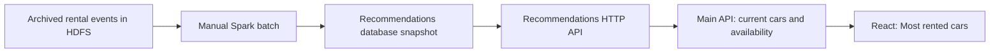

# From rental history to the public catalog

This feature displays **Most rented cars** above the fleet. It uses the most recent successful Spark snapshot, not a personalized model or a live count. The snapshot covers its preceding 30 days; creating a rental does not immediately recalculate popularity.



The browser calls only the main API (`GET /cars/recommendations`). The main API requests up to 100 ranked IDs from recommendations, removes duplicate IDs, looks up currently available cars in its own database, preserves ranking order and returns at most six car summaries. Deleted or unavailable cars are omitted. Following a card opens the existing car detail route. Renting still checks availability transactionally; appearing in the ranking does not reserve a car.

## Local walkthrough

- [ ] Follow [getting started](getting-started.md) to install prerequisites and start with `HDFS_ENABLED=true make dev`. This starts the applications and infrastructure; it does **not** execute Spark.
- [ ] Open `/cars` in the web application. Before any snapshot, expect **No recommendations yet. Browse the fleet below.** The normal filters and pagination remain usable.
- [ ] Follow [the Spark lab](recommendations-spark.md): create and return rentals, confirm their raw HDFS files, then run `make recommendations-build`. Return the rented vehicles so they can appear in the available-car ranking.
- [ ] Run `cars_recommendations` in [cars.http](../requests/http/cars.http). Expect HTTP 200 and a JSON array with no more than six available cars. Compare IDs/order with `GET http://localhost:8085/recommendations/cars?limit=100`; removed or unavailable cars are skipped.
- [ ] Reload the catalog. Check names, brands and daily prices; click a recommendation and confirm the corresponding car detail opens. Try a narrow browser width and keyboard navigation.
- [ ] Rent a recommended car. Reload the catalog: that car must disappear from recommendations while unavailable, even before another Spark run.
- [ ] Stop **only** the recommendations application. Reload the catalog: the main API returns `[]` after a bounded failed request, and the fleet still loads. Restart recommendations and reload to restore the section. Do not stop PostgreSQL or the main API for this check.
- [ ] A network/main-API failure instead shows **Could not load recommendations. Try again**. The button retries only that section. No automatic retries delay the fallback.

The optional ranking deliberately shares the same empty response for no snapshot and upstream unavailability; the API logs upstream failures. Errors from the main database are not silently treated as ranking failures.

## Configuration

| Variable | Local default | Purpose |
| --- | --- | --- |
| `RENT_RECOMMENDATIONS_URL` | `http://localhost:8085` | Service base URL used only by the main API |
| `RENT_RECOMMENDATIONS_CONNECT_TIMEOUT` | `500ms` | Connection timeout |
| `RENT_RECOMMENDATIONS_READ_TIMEOUT` | `1s` | Read timeout |

These are transport timeouts, not a strict end-to-end deadline (DNS and request setup can add time). There is no synchronous Spark work, remote retry or database transaction held while waiting for HTTP.

## Kubernetes walkthrough

- [ ] Follow [the Kubernetes section of the Spark lab](recommendations-spark.md#6-deploy-to-local-kubernetes) to build/push images and deploy with HDFS enabled. Use the repository's existing context/namespace commands.
- [ ] Confirm the API and recommendations deployments are ready. Helm configures the main API with `http://<release>-recommendations:8085`; the browser does not need a new service exposed or an additional port-forward.
- [ ] Create and return rentals through the web/API, then run `make k8s-recommendations-build`. Wait for the job to complete before looking for new results.
- [ ] Open the deployed web catalog and repeat the local ID/order, current availability and detail-navigation checks.
- [ ] In this local study cluster, scale recommendations to zero, reload the catalog and confirm it remains usable. Restore the original replica count afterward; do not scale PostgreSQL or erase volumes.

```bash
kubectl --context docker-desktop -n rent-cars get deployments fleet-api fleet-recommendations
kubectl --context docker-desktop -n rent-cars logs deployment/fleet-api --tail=50
# Optional outage exercise; first note the current replica count above.
kubectl --context docker-desktop -n rent-cars scale deployment/fleet-recommendations --replicas=0
# Restore the original count (the local default is 1).
kubectl --context docker-desktop -n rent-cars scale deployment/fleet-recommendations --replicas=1
```

## Read the implementation

1. [PopularCarsClient.java](../apps/api/src/main/java/com/github/theguuholi/rentcars/cars/PopularCarsClient.java): HTTP, timeouts and optional-ranking fallback.
2. [CarRecommendations.java](../apps/api/src/main/java/com/github/theguuholi/rentcars/cars/CarRecommendations.java): ranking order, availability lookup and six-car limit.
3. [CarRecommendationsController.java](../apps/api/src/main/java/com/github/theguuholi/rentcars/cars/CarRecommendationsController.java): public endpoint and OpenAPI contract.
4. [MostRentedCars.tsx](../apps/web/src/features/cars/components/MostRentedCars/MostRentedCars.tsx): query states and card links. Its query key starts with `cars`, so existing fleet invalidation refreshes recommendations after a rental.
5. Tests alongside these files explain each outcome with Given/When/Then.

Run `make check-api`, `make check-web` and `npm --prefix apps/web run mutation`. With the web/API running, use `npm --prefix apps/web run test:e2e -- e2e/popular-cars.pw.ts` for the browser recovery scenario. Browser network interception makes that failure deterministic; Java tests separately exercise actual HTTP timeouts and PostgreSQL availability filtering.
