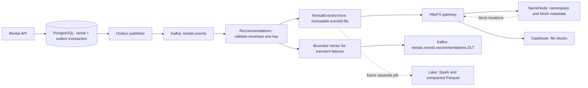

# Rental event archive: system design and study guide

This optional lab adds durable raw-event archival to the recommendations consumer.
It does not calculate recommendations or run Spark. HDFS stores files; Kafka
transports retained events; Spring Boot validates and coordinates each write.
The existing rental transaction and API remain unchanged.

## Boundaries and topology



The API owns rentals and its PostgreSQL outbox. Recommendations owns its consumer
group and archive. It has no dependency on API classes or database tables.
There is no new PostgreSQL migration or HTTP endpoint in this change.
The DLT remains a Kafka topic, not an HDFS directory or a PostgreSQL table.

The gateway avoids distributing Hadoop RPC dependencies in the Java 25 consumer.
`HdfsArchiveClient` uses Spring `RestClient` and HttpFS's WebHDFS API.
Hadoop runs in its own runtime. The official [Java compatibility matrix](https://cwiki.apache.org/confluence/spaces/HADOOP/pages/100827883/Hadoop%2BJava%2BVersions)
does not establish Hadoop 3.5 native-client compatibility with Java 25.
See the [HttpFS gateway documentation](https://hadoop.apache.org/docs/r3.5.0/hadoop-hdfs-httpfs/index.html).

## One record, step by step

```mermaid
sequenceDiagram
    participant K as Kafka
    participant C as Recommendations listener
    participant A as RentalEventArchive
    participant H as HttpFS / HDFS
    K->>C: Rental event, key = rentalId
    C->>C: Parse and validate envelope, payload shape and key
    C->>A: store(eventId, original JSON)
    A->>H: Read final eventId path
    alt Final file already exists
        H-->>A: Existing JSON
        A->>A: Compare JSON content; reject a conflicting eventId
    else No final file
        A->>H: CREATE unique temporary file, overwrite=false
        H-->>A: Completed write
        A->>H: RENAME temporary file to final eventId path
        alt Another writer won the rename
            A->>H: Read winner and verify identical JSON
        end
        A->>H: Delete remaining temporary file, if present
    end
    A-->>C: Archive succeeded or identical replay
    C-->>K: Listener returns; container commits next offset
```

The final layout is:

```text
/rent-cars/raw/rentals/<first-two-eventId-characters>/<eventId>.json
```

The UUID prefix distributes directory entries. Identity is **only `eventId`**:
a changed date cannot silently create a second file for the same event.
Date partitioning belongs in a later analytical dataset. The raw JSON retains
unknown fields and Unicode. Reordered object properties or whitespace are an
identical replay; changed values under the same ID are a conflict.

`RentalEventsConsumer` owns validation and orchestration. `RentalEventArchive`
owns immutable publication and replay checks. `HdfsArchiveClient` owns HTTP
operations. `HdfsArchiveConfiguration` supplies optional wiring and bounded
connection/read timeouts. The existing Kafka error handler owns retries and DLT.

## Guarantees and failure windows

Delivery remains **at least once**. HDFS publication and Kafka offset commits
are separate operations, not a distributed transaction or exactly-once protocol.

| Failure or replay | Expected outcome |
| --- | --- |
| Same ID and same JSON | Existing final file is accepted; no overwrite |
| Same ID and different JSON | Reject and quarantine in DLT; preserve original file |
| Two writers for the same ID | Atomic rename elects a winner; loser compares its content |
| Failure while writing temporary file | No final file is published; retry the record |
| Process crash before rename | Temporary file may remain; replay uses another unique temporary path |
| Crash after rename but before offset commit | Replay reads the final file and verifies its content |
| HDFS unavailable | Retry transient failures; after exhaustion publish to DLT |
| Both HDFS and DLT unavailable | Source offset must not advance past the failed record |
| DLT publication succeeds | Source consumption can advance; operator must replay the quarantined event after fixing the cause |

Default transient retries are three retries after the initial attempt, with
1s, 2s and 4s backoff. Validation failures are not retried. Cleanup failures also
fail the attempt; a successful final rename remains recoverable by replay.
A process kill can leave orphan `.tmp` files. They are not reader-visible final
events. Inspect and remove them only with writers stopped; automated retention
and orphan cleanup are outside this first stage.

The consumer commits via Spring Kafka `ack-mode: record` with automatic commits
disabled. Do not add manual acknowledgements before archival. DLT publication
must succeed before recovery advances the source offset. Read the companion
[DLT guide](recommendations-dlt.md) for recovery exercises and durability limits.

## Observe the pipeline

Correlate source topic/partition/offset and `eventId` with the receipt log and
final HDFS path. Kafka UI shows group progress and DLT records. The existing
`rental.consumer.failures`, `rental.consumer.dlt.published` and
`rental.consumer.dlt.failures` counters describe delivery/recovery outcomes;
they are not a separate HDFS success metric. NameNode UI shows filesystem and
block health. A healthy consumer process alone does not prove successful
archival; inspect both committed offsets and the final file.

## Run the local lab

Requirements: Java 25, Docker, enough memory for Kafka plus three Hadoop JVMs.
The default environment does not start HDFS. From the repository root:

```sh
make dev HDFS_ENABLED=true
# Or run only the consumer and its supporting infrastructure:
make recommendations-dev HDFS_ENABLED=true
```

Use one command, not both simultaneously. The optional Compose profile starts
NameNode, DataNode and HttpFS with persistent NameNode/DataNode volumes.
Application startup never formats an existing NameNode directory.
`make infra-stop` stops these services and preserves their volumes.
A database reset does not reset HDFS.

| Address | Purpose |
| --- | --- |
| http://localhost:8084 | Kafka UI: source events, group offsets and DLT |
| http://localhost:9870 | HDFS NameNode UI and file browser |
| http://localhost:14000/webhdfs/v1/ | HttpFS API, not an application UI |

1. Start the lab with archival enabled.
2. Open or return a rental through the existing UI or REST Client examples.
3. Find its `eventId` in `rentals.events` in Kafka UI.
4. Check the consumer receipt and consumer-group offset.
5. Browse the matching HDFS prefix directory or run:

```sh
curl --fail 'http://localhost:14000/webhdfs/v1/rent-cars/raw/rentals?op=LISTSTATUS&user.name=hadoop'
# Replace PREFIX and EVENT_ID with the event's actual UUID prefix and UUID:
curl --fail 'http://localhost:14000/webhdfs/v1/rent-cars/raw/rentals/PREFIX/EVENT_ID.json?op=OPEN&user.name=hadoop'
```

6. Replay the same raw event with the same Kafka key. Verify one final file.
7. Stop HttpFS (`docker compose stop hdfs-httpfs`), publish another event and
   observe retries followed by DLT recovery. Restore it with
   `docker compose --profile hdfs up -d --wait hdfs-httpfs`, then manually replay
   the DLT record to the source with its original key and JSON. Other consumer
   groups also see a source-topic replay; coordinate operational replays.

**Switching from receipt-only mode does not backfill committed events.** Use a
new group to archive retained history, for example:

```sh
RECOMMENDATIONS_GROUP_ID=rent-cars-hdfs-study make recommendations-dev HDFS_ENABLED=true
```

A new group with `earliest` starts at the earliest retained offset. It cannot
recover events already removed by Kafka retention. Once an archival group is
in use, keep archival enabled for it; disabling it would acknowledge new events
without writing them. The archive itself currently has no automatic expiry. Raw events contain account
identifiers: define access controls, retention and deletion obligations before
using real customer data.

| Variable | Default |
| --- | --- |
| `HDFS_ARCHIVE_ENABLED` | `false` |
| `HDFS_HTTPFS_URL` | `http://localhost:14000` |
| `HDFS_USER` | `hadoop` |
| `HDFS_ARCHIVE_ROOT` | `/rent-cars/raw/rentals` |

## Kubernetes lab

Stop the local environment before selecting Kubernetes, as required by the
existing environment guard. Build/publish the updated recommendations image
using the repository image workflow before deploying it.

```sh
make k8s-up HDFS_ENABLED=true
kubectl --context docker-desktop -n rent-cars get pods,pvc
kubectl --context docker-desktop -n rent-cars logs statefulset/fleet-hdfs-namenode
# Separate terminal: inspect the internal NameNode UI locally.
kubectl --context docker-desktop -n rent-cars port-forward service/fleet-hdfs-namenode 9870:9870
# Optional, another terminal: run the same HttpFS curl examples.
kubectl --context docker-desktop -n rent-cars port-forward service/fleet-hdfs-httpfs 14000:14000
```

These commands match this branch’s existing `make k8s-up`: context
`docker-desktop`, namespace `rent-cars`, release `fleet`. The
consumer reaches HttpFS through its internal Service; it does not need a port
forward. An init container waits for a successful HDFS listing before the
consumer starts, avoiding DLT recovery caused solely by initial startup order. NameNode and DataNode each have a persistent volume claim. Retain both
when restarting the lab. Deleting their PVCs deletes the archive or its metadata.

The pinned Apache Hadoop 3.5.0 image is **linux/amd64**. Compose explicitly uses
that platform; ARM Docker Desktop requires emulation. Kubernetes needs a
compatible node/runtime or a verified ARM image supplied through `hdfs.image`.
Helm rendering alone does not prove image compatibility with your cluster.
The lab uses TCP startup/readiness probes, not an end-to-end archive health check.

## Local lab versus production

This is an explicit learning environment: one NameNode, one DataNode,
replication factor 1, simple authentication and disabled HDFS permissions.
It is not a production-ready Hadoop cluster. Keep these endpoints private.
Production requires a separate capacity/security design: authenticated encrypted
access, authorization, NameNode HA, multiple DataNodes across failure domains,
replication policy, backups, retention and monitoring. The current HTTP client
uses pseudo-authentication and must evolve before connecting to a secured cluster.

One JSON file per event makes identity and crash recovery easy to study, but
creates a small-file problem at scale. Do not extrapolate this design directly
to 100,000 rentals/day. A later Spark job can compact validated raw events into
larger Parquet files partitioned by analytical date, without changing the rental
transaction. YARN, MapReduce, Spark and recommendation models are not installed.

## Verification and study questions

```sh
make check-recommendations
cd apps/recommendations
./mvnw -B -Pmutation test-compile org.pitest:pitest-maven:mutationCoverage
```

Given/When/Then tests cover HTTP protocol/UTF-8, identical and conflicting replays,
concurrent writes, cleanup, real HDFS persistence, Kafka commits and HDFS/DLT
outages. Kafka and HDFS integration tests use real containers, not mock storage.
Coverage and mutation limits remain unchanged. Consult the PR for actual run
results; commands in this guide are instructions, not a claim that CI passed.

For review, explain: why is the offset committed last? What if the process dies
between rename and commit? Why does a DLT record still require operator action?
Why is `eventId` used for storage identity while `rentalId` is the Kafka key?
Why is HDFS replication separate from Kafka replication?

Further reading: [HDFS architecture](https://hadoop.apache.org/docs/r3.4.3/hadoop-project-dist/hadoop-hdfs/HdfsDesign.html),
[WebHDFS operations](https://hadoop.apache.org/docs/current/hadoop-project-dist/hadoop-hdfs/WebHDFS.html),
and the [Kafka retries/DLT study guide](recommendations-dlt.md).
