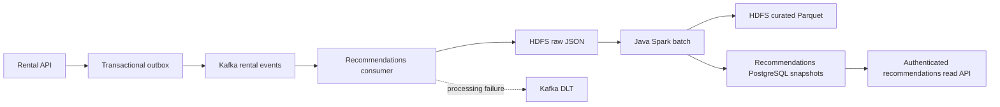

# Spark recommendations: a step-by-step lab

## 1. Understand the system before starting it

- [ ] Read [the Hadoop lab](recommendations-hdfs.md): HDFS stores the original rental JSON. Kafka delivers events; HDFS is not a queue.
- [ ] Read [Apache Spark overview](https://spark.apache.org/docs/4.1.0/): Spark computes over stored data; it is not the HTTP server.
- [ ] Find the [event contract](events/rentals.md). An opening and a return are two events for one rental. Counting every event would inflate popularity.



Main API and React do not call this new API yet. That integration is the next PR. The result is historical popularity, not a guarantee that a car exists or is available now.

## 2. Start locally

- [ ] Install the normal prerequisites from [getting started](getting-started.md). Only direct job development requires JDK 21; Docker builds provide it automatically.
- [ ] Stop Kubernetes using `make k8s-stop` if it is active. Keep its volumes.
- [ ] Run:

```sh
make setup
make dev HDFS_ENABLED=true
```

The existing services start, plus a separate recommendations PostgreSQL database at localhost:5433. The recommendations service runs on localhost:8085 and applies its own migration. The main API continues using its existing database.

- [ ] Open http://localhost:8085/swagger-ui/index.html. Authenticate with `rent-cars` / `recommendations-dev` (development only).
- [ ] Open [recommendations.http](../requests/http/recommendations.http), send request 1. Before any batch, expect `items: []`, `asOf: null`, `generatedAt: null`. Missing credentials must return 401; limit 101 must return 400.
- [ ] Use [the rental walkthrough](getting-started.md) to open and return rentals for several cars. Complete [HDFS lab checkpoints](recommendations-hdfs.md) to confirm their JSON files exist. A DLT record is not an archived event and cannot contribute until replay succeeds.

## 3. Compute the first ranking

- [ ] From another terminal in the repository root:

```sh
make recommendations-build
```

This builds the independent Spark image and runs one batch on the Compose network. It does not run forever or change the rental transaction. The recommendations service must already have created the database schema.

For reproducibility, choose a cutoff after the test events:

```sh
RECOMMENDATIONS_AS_OF=2026-11-24T00:00:00Z make recommendations-build
```

- [ ] Read `PopularityRanking.java` in `apps/recommendations-job`: explicit schema → validate → deduplicate → keep opens → thirty-day window → count distinct rentals → sort → bound the snapshot.
- [ ] Confirm a duplicated event or a return does not increase the score. Same-score cars are ordered by UUID.
- [ ] Send request 1 again. Check `algorithm: popular-cars-v1`, `asOf`, `generatedAt`, car IDs, ranks and scores.
- [ ] Inspect the independent database:

```sh
docker compose exec recommendations-db psql -U recommendations -d recommendations \
  -c 'SELECT as_of, generated_at, algorithm, jsonb_array_length(items), parquet_path FROM recommendation_snapshots ORDER BY as_of DESC;'
```

`score` is an integer count, not a probability. A car without an opening in the window does not appear. The endpoint returns at most 100 cars; the batch stores at most 1,000.

- [ ] Inspect the curated files:

```sh
docker compose exec hdfs-namenode hdfs dfs -ls -R /rent-cars/curated/popular-cars
```

Parquet is a typed columnar format, so downloading it and reading it as JSON will not work. Spark can read it using `spark.read().parquet(path)`; inspect the schema and rows in a Spark shell or the job tests.

## 4. Prove publication safety

- [ ] Run the same cutoff twice. PostgreSQL keeps the first committed snapshot for that cutoff. Scores do not accumulate. A later cutoff allows late-arriving events to enter a new calculation.
- [ ] Run an older cutoff after a newer cutoff. The API still selects the newer cutoff, irrespective of completion order.
- [ ] In a disposable local environment, pause storage and run a batch:

```sh
docker compose stop hdfs-datanode
# --no-deps avoids Compose restarting it for this failure experiment.
RECOMMENDATIONS_AS_OF=$(date -u +%Y-%m-%dT%H:%M:%SZ) \
  docker compose --profile hdfs --profile spark run --no-deps --rm recommendations-job
```

The batch must fail, and the API must keep the previous snapshot. Restore with `docker compose --profile hdfs up -d --wait hdfs-datanode` before retrying. HDFS operations can wait for their network timeout; inspect logs rather than expecting an immediate failure.

- [ ] Read `SnapshotPublisherTest`: a failed PostgreSQL insert cannot erase the old snapshot. Publication is one atomic insert, not a loop of visible row updates.
- [ ] Explain the limit: Parquet and PostgreSQL do not share a transaction. If Parquet succeeds but PostgreSQL fails, an unreferenced directory may remain. Readers still see the prior complete result. Cleanup is an operational follow-up, not a reason to publish partial data.

## 5. Verify the code

- [ ] Service, JDK 25: `make check-recommendations`.
- [ ] Job, JDK 21: `JAVA21_HOME=/path/to/jdk-21 make check-recommendations-job`.
- [ ] Run the PIT commands in [service README](../apps/recommendations/README.md) and [job README](../apps/recommendations-job/README.md). Both enforce 100% coverage and mutation thresholds.
- [ ] Inspect tests for window boundaries, distinct rentals, duplicate/conflicting events, empty history, authentication, bounds and publication failures. Check observable outcomes rather than only line coverage.

## 6. Deploy to local Kubernetes

- [ ] Stop `make dev` with Ctrl+C, then `make infra-stop`. Keep volumes.
- [ ] Build and push images with the existing registry script, which now includes `rent-cars-recommendations-job`:

```sh
IMAGE_NAMESPACE=docker.io/guuhworship sh scripts/push-images.sh
make k8s-up HDFS_ENABLED=true
```

All resources remain in `rent-cars`, context `docker-desktop`. Make creates a separate recommendations credentials Secret if missing. It never prints generated passwords. The application applies Flyway before becoming ready. The job does not manage migrations.

- [ ] Confirm service and database readiness:

```sh
kubectl --context docker-desktop -n rent-cars get pods,svc,cronjobs
kubectl --context docker-desktop -n rent-cars logs deployment/fleet-recommendations --tail=50
```

- [ ] Create rentals and verify HDFS archival using the existing Kubernetes lab.
- [ ] Run the first deliberate batch:

```sh
make k8s-recommendations-build
kubectl --context docker-desktop -n rent-cars get jobs
# Substitute the Job name printed by make:
kubectl --context docker-desktop -n rent-cars logs -f job/JOB_NAME
kubectl --context docker-desktop -n rent-cars wait --for=condition=complete job/JOB_NAME --timeout=300s
```

The CronJob is suspended by default. Manual jobs can still run. `concurrencyPolicy: Forbid` prevents overlaps for scheduled executions, not manual jobs; immutable cutoff publication remains necessary.

- [ ] For inspection only, tunnel the internal API:

```sh
kubectl --context docker-desktop -n rent-cars port-forward service/fleet-recommendations 8085:8085
```

In another terminal, retrieve the local Secret into a shell variable and call the API (do not commit or paste credentials):

```sh
recommendations_password=$(kubectl --context docker-desktop -n rent-cars get secret recommendations-credentials -o jsonpath='{.data.api-password}' | base64 --decode)
curl --fail --user "rent-cars:$recommendations_password" 'http://localhost:8085/recommendations/cars?limit=10'
unset recommendations_password
```

Use those credentials in the REST Client locally if desired. Kubernetes does not use the development password. Production Basic authentication must run over TLS or a TLS service mesh; ClusterIP alone is not authentication or encryption.

- [ ] Only after a successful manual run, enable scheduling through Helm values (`recommendations.job.suspend=false`). Keep the same values file when upgrading; `make k8s-up` intentionally resets to local defaults.
- [ ] Explain that this initial Kubernetes Job uses Spark `local[2]` within one pod. It does not yet create distributed executor pods or require a Spark operator.

## Further reading

- [Spark SQL and DataFrames](https://spark.apache.org/docs/4.1.0/sql-programming-guide.html)
- [Parquet](https://spark.apache.org/docs/4.1.0/sql-data-sources-parquet.html)
- [Spark on Kubernetes](https://spark.apache.org/docs/4.1.0/running-on-kubernetes.html) — next scaling step, not what local mode currently does.
- [PostgreSQL transactions](https://www.postgresql.org/docs/17/tutorial-transactions.html)
- [Kubernetes CronJobs](https://kubernetes.io/docs/concepts/workloads/controllers/cron-jobs/)
