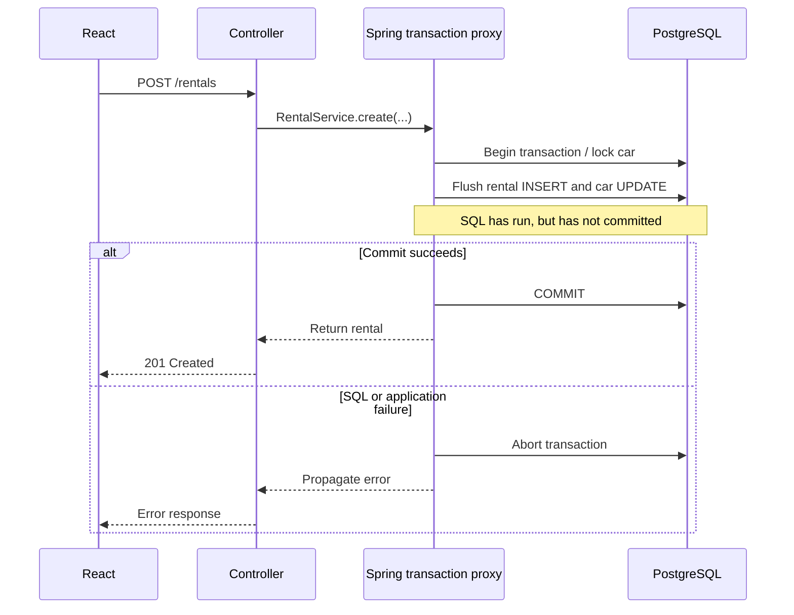

# Study lab: ACID, rollback and rental recovery

Goal: explain why opening a rental and making its car unavailable must succeed
or fail together, then observe what the browser can and cannot infer from an error.
Start with the [relational integrity lab](rental-database-integrity.md).
This lab adds tests and recovery guidance; the service already has the required
transaction boundary. No migration or production failure switch is needed.

## 1. Follow one request

Read these files in order:

1. [`RentalController.create`](../../apps/api/src/main/java/com/github/theguuholi/rentcars/rentals/RentalController.java): identifies the authenticated account and calls the service.
2. [`RentalService.create`](../../apps/api/src/main/java/com/github/theguuholi/rentcars/rentals/RentalService.java): owns the transaction, checks the rental, reserves the car and saves the rental.
3. [`CarRentalAccess`](../../apps/api/src/main/java/com/github/theguuholi/rentcars/cars/CarRentalAccess.java): requires the caller's transaction (`MANDATORY`) and locks the car for competing writes.
4. [`RentalRepositoryTest.Atomicity`](../../apps/api/src/test/java/com/github/theguuholi/rentcars/rentals/RentalRepositoryTest.java): proves rollback with real PostgreSQL writes.
5. [`RentalActions`](../../apps/web/src/features/rentals/components/RentalActions/RentalActions.tsx): keeps the return date after failure and offers a read-only status check.



The car is a managed JPA entity. Calling `car.rent()` changes it in memory;
Hibernate's dirty checking persists that change when the persistence context is
flushed. `saveAndFlush(rental)` flushes pending changes, including the car, but
it does **not** commit the service transaction. The caller only receives a normal
return after the Spring proxy completes the transaction.

- [ ] I can locate the transaction boundary and explain why there is no separate `cars.save()` here.
- [ ] I can distinguish `save`, `flush`, and `commit` using this request.

## 2. Map ACID to this application

| Property | Meaning in this rental operation | Evidence and limits |
| --- | --- | --- |
| Atomicity | Rental creation and car unavailability persist together or neither persists. | The new commit-failure test verifies no rental, available car and unchanged car version after failure. |
| Consistency | A committed rental respects the declared database constraints and business rules. | V10's FK, CHECK and unique partial indexes; service rules; the preceding integrity lab. A transaction does not invent missing constraints. |
| Isolation | Another connection must not observe this transaction's unfinished writes. | The new second-connection test reads the original availability and no rental while the writer sees both changes. Existing `RentalConcurrencyTest` exercises competing writers. This is not a claim of serializable isolation. |
| Durability | A successful commit survives later database recovery under the configured persistence guarantees. | The tests reread committed records, but do not simulate a power failure. PostgreSQL durability, storage and backup configuration remain deployment responsibilities. |

PostgreSQL groups writes into a transaction and discards them on rollback;
read its [transaction tutorial](https://www.postgresql.org/docs/17/tutorial-transactions.html).
At PostgreSQL's default Read Committed level, each statement sees a snapshot of
committed data; it does not see another transaction's unfinished writes. Review
[isolation levels](https://www.postgresql.org/docs/17/transaction-iso.html) before
assuming all queries in a transaction share one immutable snapshot.

## 3. Run the rollback experiments

With JDK 25 and Docker running, from the repository root:

```sh
cd apps/api
./mvnw -B -Dtest=RentalRepositoryTest test
```

These tests use a disposable PostgreSQL container, not the development database.
The test class is not annotated with `@Transactional`, so the service's own commit
is exercised rather than hidden by automatic test rollback.

**Experiment A — failure at commit:**
`givenBothWritesFlushedWhenCommitFailsThenRentalAvailabilityAndVersionRollBack`:

1. Store the car version before the request.
2. Install a test-only deferred constraint trigger.
3. Call the actual Spring-managed `RentalService`, with a valid account and car.
4. At commit, the trigger checks that the rental exists and the car is unavailable
   inside that transaction. Only then does it raise the intentional `P0001` error.
   If either write is absent it raises a different `P0002` error and the test fails.
5. Remove the trigger and function in `finally`.
6. Read committed state: no rental; car available; original version unchanged.
7. Retry successfully: exactly one rental and the car unavailable.

Deferred constraint triggers can execute at the end of the transaction, which makes
this failure deterministic without mocking the repository or depending on Hibernate's
SQL ordering. See [PostgreSQL CREATE TRIGGER](https://www.postgresql.org/docs/17/sql-createtrigger.html).
Do not install this test trigger in a shared or production database.

**Experiment B — application failure after flush:**
`givenFlushedWritesWhenRuntimeFailureEscapesThenOtherConnectionsNeverSeePartialState`:

1. A `TransactionTemplate` starts an outer transaction; the service joins it.
2. The writer sees its own rental and unavailable car after flush.
3. A separate thread/connection reads no rental and the original availability.
4. An intentional `IllegalStateException` escapes the transaction callback.
5. Fresh reads after rollback still show no rental and an available car.

The second connection is deliberate: a JDBC read on the writer's thread joins its
transaction and sees its unfinished writes. A mock-based unit test cannot prove
this PostgreSQL visibility or commit behavior.

- [ ] I can explain why the earlier missing-account FK test alone did not prove both writes had executed.
- [ ] I can explain why the trigger is deferred and why the test asserts its exact error.
- [ ] I can show which assertions happen before rollback and which happen after it.

## 4. Understand Spring rollback rules

Spring's usual defaults roll back for unchecked exceptions (`RuntimeException`)
and `Error`; checked exceptions need an explicit rollback policy when rollback
is intended. Catching and swallowing an exception may let a transaction commit,
or may cause an eventual rollback-only error if a participating operation already
marked it for rollback. Read [Spring rollback rules](https://docs.spring.io/spring-framework/reference/data-access/transaction/declarative/rolling-back.html).

The annotation works through a Spring proxy. Calling an annotated method on a
manually constructed object, or self-invocation that bypasses the proxy, does not
start a new annotated transaction. Read [Using @Transactional](https://docs.spring.io/spring-framework/reference/data-access/transaction/declarative/annotations.html).

This operation deliberately keeps both writes in one transaction. Moving one write
to `REQUIRES_NEW` would permit partial commits. Database rollback also does not undo
an email, an S3 upload, or a message already sent outside that database transaction.
Those operations need a separate delivery/consistency design when introduced.

## 5. Explore frontend recovery

Start the local stack using `make setup` and `make dev`. In another terminal:

```sh
npm --prefix apps/web run test:e2e -- e2e/rental-recovery.pw.ts --workers=1
```

The browser scenarios register a driver, select an available car, and choose a
return date. They then test two deliberately different failures:

| Browser experiment | What actually happened | Expected recovery |
| --- | --- | --- |
| Request intercepted before reaching the API | No rental was created. This is a UI failure simulation, **not proof of database rollback**. | Date is preserved; status check performs GET; a deliberate retry can succeed. |
| API returns 201 but Playwright replaces the response with 500 | The real backend committed; only the browser lost the successful response. | Status check discovers the open rental and shows Return car, without another POST. |

In both cases the page avoids claiming success or claiming rollback from an error.
“Check rental status” reads `GET /rentals`; it does not retry the write. Inputs and
the check button are disabled during the check. If that read also fails, the page
shows a recovery error and allows another check. A new submission clears the old
status confirmation. The draft is retained in the mounted form, not persisted
across page reloads or navigation.

For manual observation, open browser Network tools and inspect the POST followed
by the status-check GET. For a real transaction failure, run the PostgreSQL tests
above. The frontend interception does not replace those integration tests.

HTTP Yac remains unchanged: use `requests/http/rentals.http` → `rentals_create`,
`rentals_list`, and `rentals_return`, following the driver setup in
[the onboarding guide](../getting-started.md). There is no public endpoint to force
rollback. After an uncertain POST, list rentals before deciding to send it again.

## 6. Review questions

1. Why can a successful `saveAndFlush` still be followed by rollback?
2. Why must availability and the rental share the same transaction?
3. Which mechanism protects competing requests: the transaction boundary, car lock,
   unique indexes, or a combination? Explain the role of each.
4. Does HTTP 500 prove the transaction did not commit? Use the browser test to answer.
5. Does a green Testcontainers test establish production durability after a disk failure?
6. What would change if the operation also published a Kafka event?

For PR review, first read the service boundary, then the two atomicity tests, then
the frontend recovery tests. Run `make check` for the full verification suite.
