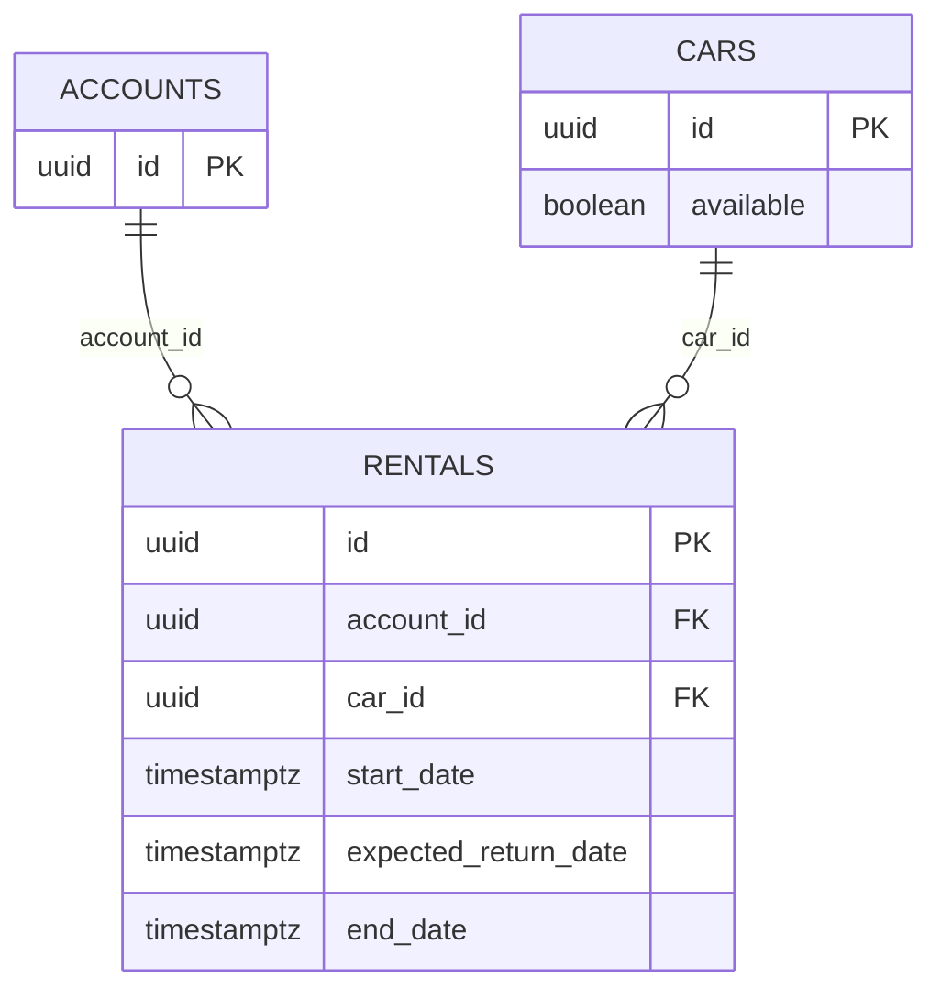

# Study lab: relational integrity of rentals

This lab uses the real Rent Cars schema and PostgreSQL integration tests. Its goal
is to explain which rules the database guarantees even when a write bypasses
the HTTP API. Work from the repository root. No schema change is needed.

## Step 1: Read the model and predict the result

Read [`V5__create_accounts.sql`](../../apps/api/src/main/resources/db/migration/V5__create_accounts.sql),
[`V4__create_cars.sql`](../../apps/api/src/main/resources/db/migration/V4__create_cars.sql),
and [`V10__create_rentals.sql`](../../apps/api/src/main/resources/db/migration/V10__create_rentals.sql).
Draw the identifiers and required relationships before reading the table below.



| Attempted write | Database rule | Expected result |
| --- | --- | --- |
| Rental with an unknown car | `rentals.car_id` foreign key | `23503` (`foreign_key_violation`) |
| Expected return less than 24 hours after start | `rentals_period` check | `23514` (`check_violation`) |
| Second open rental for one car | `rentals_open_car` unique partial index | `23505` (`unique_violation`) |
| Second open rental for one account, even with another car | `rentals_open_account` unique partial index | `23505` (`unique_violation`) |
| New rental after the previous one has `end_date` | Partial index predicate no longer includes the old row | Accepted if the car is available |

The two indexes only include rows whose `end_date IS NULL`. Historical rentals
remain in the table. The `rentals_return` check also requires an open rental
to have no total and a returned rental to have a valid end date and total.
The foreign keys use `ON DELETE RESTRICT` to preserve rental history.

- [ ] I can point to each relationship and rule in the migrations and predict
  which write each one rejects.

## Step 2: Run the controlled experiments

Run the focused PostgreSQL integration test. It uses Testcontainers, so the
rejected writes cannot alter your development database.

```sh
cd apps/api
./mvnw -B -Dtest=RentalRepositoryTest test
```

Open [`RentalRepositoryTest.java`](../../apps/api/src/test/java/com/github/theguuholi/rentcars/rentals/RentalRepositoryTest.java).
In `DatabaseGuarantees`, find the direct `INSERT` calls for the missing car,
short period, and duplicate open rentals. For each one, write down the SQLSTATE,
constraint name, and number of rows left in `rentals`. Compare your prediction
from Step 1 with the assertions. The test for a missing account additionally
checks that a failed rental does not leave the car unavailable.
[`RentalControllerTest.java`](../../apps/api/src/test/java/com/github/theguuholi/rentcars/rentals/RentalControllerTest.java)
also exercises renting the same car again after its earlier rental was returned.

If you also want to inspect the migrated schema manually, start `make dev` in
another terminal and connect to the local development database:

```sh
docker compose exec postgres psql -U postgres -d rent_cars_dev
```

Inside `psql`, run `\d rentals` and `\d cars`. Then inspect the index predicates:

```sql
SELECT indexname, indexdef
FROM pg_indexes
WHERE tablename = 'rentals'
ORDER BY indexname;
```

This manual inspection is read-only. Keep the failed-write experiments in
Testcontainers; run no `DROP INDEX` or migration edits on the development DB.

- [ ] I can distinguish a foreign key violation, a check violation, and a
  unique-index violation by SQLSTATE and constraint name.

## Step 3: Trace a race condition

Read [`RentalService.java`](../../apps/api/src/main/java/com/github/theguuholi/rentcars/rentals/RentalService.java),
[`CarRentalAccess.java`](../../apps/api/src/main/java/com/github/theguuholi/rentcars/cars/CarRentalAccess.java),
[`CarRepository.java`](../../apps/api/src/main/java/com/github/theguuholi/rentcars/cars/CarRepository.java),
and [`RentalRepository.java`](../../apps/api/src/main/java/com/github/theguuholi/rentcars/rentals/RentalRepository.java).
Then read `ConcurrentWrites` in `RentalRepositoryTest.java`.

1. Two drivers request the same car. `findForUpdate` takes a pessimistic write
   lock on the car, so one transaction waits while the other rents it. The
   waiting transaction sees the new availability after the first commits.
   `rentals_open_car` remains the database guarantee for any competing write,
   including one that bypasses the service.
2. One driver requests two *different* cars. Locking each car does not serialize
   those requests by account. Both could pass the application's preliminary
   `existsByAccountIdAndEndDateIsNull` check. `rentals_open_account` guarantees
   that only one open rental commits.
3. Two requests return the same rental. `findForReturn` locks its rental row;
   the first return completes and the second cannot finish it again.

These scenarios are already tested with competing PostgreSQL transactions.
They assert one committed operation and one conflict, then inspect persisted
state. A direct SQL violation is different from an HTTP response: the API's
exception mapping is what turns a relevant conflict into HTTP 409.

For comparison, car catalog edits use the `@Version` field in
[`VersionedEntity.java`](../../apps/api/src/main/java/com/github/theguuholi/rentcars/shared/persistence/VersionedEntity.java)
and the editor's `expectedVersion`. That optimistic version protects edits
against stale data. It does not replace the rental-specific locks or partial
unique indexes. Do not remove a lock or index as part of this lab.

- [ ] I can explain which two requests contend for the same row, which do not,
  and why both partial indexes are still needed.

## Step 4: Explain the design

Answer these questions in the PR review or your own notes:

1. Why is a Java `exists` check insufficient to guarantee one open rental under
   concurrent requests?
2. Why can the same car be rented again after a return without deleting its
   historical rental?
3. What does a pessimistic lock protect here, and what does `@Version` protect?
4. What would a direct SQL writer bypass, and what would PostgreSQL still reject?
5. Which observations come from a Testcontainers test, and which come from the
   public HTTP contract?

Run the repository's full backend check before finishing:

```sh
make check-api
```

- [ ] I can answer all five questions and the backend check passes.

## Read after the code exercise

1. [PostgreSQL 17: constraints](https://www.postgresql.org/docs/17/ddl-constraints.html)
   explains primary keys, foreign keys, checks, and delete actions.
2. [PostgreSQL 17: unique indexes](https://www.postgresql.org/docs/17/indexes-unique.html)
   and [partial indexes](https://www.postgresql.org/docs/17/indexes-partial.html)
   explain why `WHERE end_date IS NULL` protects only open rentals.
3. [PostgreSQL 17: SQLSTATE codes](https://www.postgresql.org/docs/17/errcodes-appendix.html)
   lists the stable error categories used in the tests.
4. [PostgreSQL 17: transactions](https://www.postgresql.org/docs/17/tutorial-transactions.html)
   and [explicit locking](https://www.postgresql.org/docs/17/explicit-locking.html)
   explain rollback, row locks, and waiting transactions.
5. [Flyway: versioned migrations](https://documentation.red-gate.com/fd/versioned-migrations-273973333.html)
   explains why a future schema change requires a new migration rather than
   editing V10 after it has been applied.

Read replicas and sharding are outside this lab: the integrity and concurrent
write guarantees here are local to the primary PostgreSQL database.
